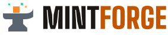
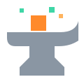
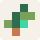

# Marke MINTforge

**Wissen schmieden.** Eine Dachmarke („Esse“) und vier Bereiche für die Website, dazu „Pixelpuls“ als Ebene für
Schüler:innen im Spiel und im Dashboard. Entschieden am 01.11.2026, beschrieben in
[`docs/konzept.md`](../docs/konzept.md#markensystem-entschieden-am-01112026). Die Website zeigt alles auch auf der Seite
[Marke](https://apachler.github.io/mintforge/marke/).

## So funktioniert es

```text
brand/tokens.json  ──►  brand/build_brand.py  ──►  brand/logo/*.svg, brand/bereiche/*.svg
(einzige Quelle)        (prüft Kontraste,          website/public/brand/…, website/public/favicon.svg
                         erzeugt alles)            website/src/styles/tokens.css
```

```sh
cd website && npm ci            # einmal: liefert die Schrift für die Wortmarke
python3 brand/build_brand.py    # im Repo-Wurzelordner (oder: npm run brand in website/)
python3 brand/build_brand.py --check   # nur Kontraste prüfen
```

- **Nie von Hand bearbeiten:** SVGs und `tokens.css` sind Erzeugnisse. Farbe, Schrift oder Abstand ändern heißt
  `tokens.json` ändern und den Generator laufen lassen. Die Erzeugnisse werden mitcommittet; CI (`site`) lässt den
  Generator erneut laufen und schlägt fehl, wenn etwas nicht aktuell ist.
- Der Generator braucht nur die Python-Standardbibliothek. Die Wortmarke „MINTforge“ wird aus Big Shoulders Display
  (aus dem npm-Paket `@fontsource/big-shoulders-display`) in Pfade umgewandelt, damit das Logo ohne Schrift überall
  gleich aussieht.
- Vor dem Schreiben prüft der Generator alle in `tokens.json` → `kontrast` genannten Farbpaare nach WCAG 2.2
  (Text 4,5:1, Logo und große Schrift 3:1) und bricht bei einem Verstoß ab.

## Logos

| Datei | Einsatz |
|---|---|
|  `logo/lockup-hell.svg` | auf hellem Grund (Licht, Weiß) |
| `logo/lockup-dunkel.svg` | auf dunklem Grund (Eisen) – Kopf und Fuß der Website |
|  `logo/bildmarke.svg` | Bildmarke allein, ab 24 px |
| `logo/favicon.svg` | Favicon, Bildmarke auf Eisen |

Amboss mit glühendem Block und drei Funken; Wortmarke „MINT“ plus „forge“ in Glut, in Großbuchstaben gesetzt.

## Farben

### Dachmarke Esse

| Name | Wert | Einsatz |
|---|---|---|
| Eisen | `#1A1714` | dunkle Flächen (Kopf, Hero, Fuß), Text auf Hell |
| Glut | `#FF8A2B` | „forge“, glühender Block, Flächen – **nie als Text auf Hell** |
| Funke | `#FFB45E` | Slogan und Links auf Dunkel – **nie als Text auf Hell** |
| Stahl | `#8A96A3` | Amboss auf Dunkel |
| Licht | `#F4EDE4` | heller Grund der Website, Text auf Dunkel |

### Gemeinsamer Akzent

| Name | Wert | Bedeutung |
|---|---|---|
| Minze | `#3FD6A6` | **immer** erledigt, freigeschaltet, nächster Schritt – nie Dekoration. Text darauf: `#062A1F` |

### Textvarianten für hellen Grund

Glut, Funke, Minze und Stahl erreichen auf Licht nicht 4,5:1. Auf hellem Grund gelten diese Varianten:

| Name | Wert | Kontrast auf Licht | Einsatz |
|---|---|---|---|
| glut-tief | `#9A4400` | 5,65:1 | Links, Kennzeichnungen |
| glut-logo | `#C45500` | 3,89:1 | nur „forge“ im Logo auf Hell (große Schrift) |
| minze-tief | `#08705A` | 5,20:1 | „erledigt“ als Text |
| stahl-tief | `#5A6470` | 5,18:1 | Amboss im Logo auf Hell |
| eisen-weich | `#5C5249` | 6,56:1 | leiser Text |

### Bereiche

| Bereich | Fächer | Farben | Muster |
|---|---|---|---|
|  **Blaupause** | Technik, Mathematik | `#0F3D7A` `#8FB8FF` `#F4F8FF` | Rasterpapier |
|  **Labor** | Naturwissenschaften | `#0B4F4A` `#B8A1FF` `#FFD23F` `#F2F7F6` | Laborkacheln |
|  **Biom** | Ökologie, Systeme | `#2F6B4F` `#7BA05B` `#C8794A` `#F5F1E8` | Blattpunkte |
|  **Schaltwerk** | Informatik | `#0E2A22` `#C98A4B` `#E8C170` `#EAF4EE` | Leiterbahnen |
|  **Pixelpuls** | Ebene für Schüler:innen | `#17112B` `#FF4FA3` `#FFE45E` | Bildschirmzeilen |

Alle Werte und die Rollen in der Quest-Karte („Haut“) stehen in `tokens.json`.

## Schrift

| Rolle | Schrift | Schnitte |
|---|---|---|
| Überschriften (Großbuchstaben) | Big Shoulders Display | 800, 900 |
| Text | Work Sans | 400, 500, 600 |
| Daten, Kennzeichnungen | JetBrains Mono | 500, 700 |
| nur Pixelpuls | Silkscreen | – (nicht auf der Website) |

Alle unter der SIL Open Font License, selbst gehostet über die npm-Pakete `@fontsource/*` – keine Google-Fonts-Links.

## Regeln

- **Ein Logo:** Amboss und Schriftzug bleiben überall gleich; Bereiche ergänzen nur ein eigenes Symbol, nie ein eigenes Logo.
- **Minze als roter Faden:** bedeutet überall dasselbe – erledigt, freigeschaltet, nächster Schritt.
- **Gleiche Bausteine:** Quest-Karte, Stufen Bronze/Silber/Gold, Kennzeichnung von Fach, Stufe und Dauer.
- **Block-Raster:** Symbole aus Quadraten und geraden Linien, 8-px-Raster, kleine Radien.
- **Website hell** mit dunklen Akzenten aus der Dachmarke (Kopf, Hero, Fuß); dunkler Modus als Variante.
- **Kontrast:** Glut, Funke, Minze nie als Textfarbe auf Hell – nur als Fläche oder in der dunkleren Variante.
- **Pixelpuls** nur im Spiel und im Dashboard, nicht auf der Website.
- Keine Minecraft-/Mojang-Grafiken oder -Schriften, kein „Minecraft“ im Namen oder Logo.

Name und Logo sind von den freien Lizenzen des Repos ausgenommen.
