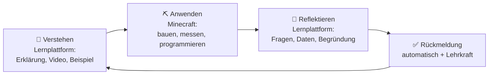
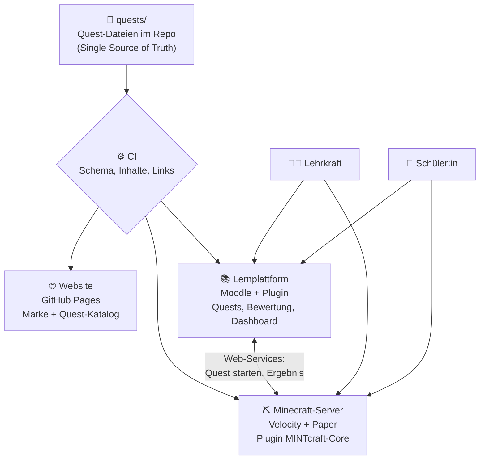
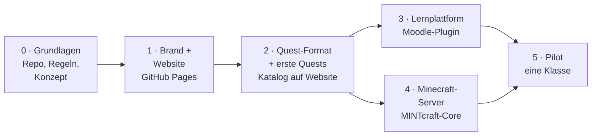
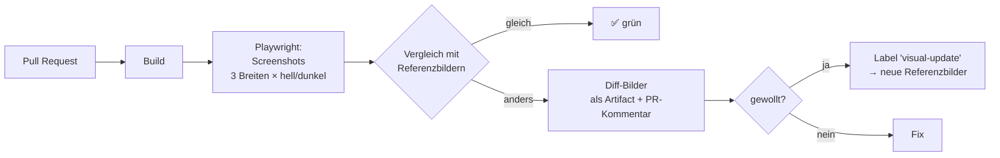

# MINTcraft – Konzeptpapier

**Lernen mit Kopf, Hand und Blöcken.** Eine Lernplattform für Mathematik, Informatik, Naturwissenschaften und Technik,
die Minecraft als Labor und eine Lernplattform als Forschungsheft verbindet – für den deutschsprachigen Raum, von der
Volksschule bis zur HTL.

| | |
|---|---|
| Stand | 31.10.2026, Entwurf 1 |
| Verantwortlich | Andreas Pachler |
| Status | Phase 0 (Grundlagen) abgeschlossen mit diesem Dokument, Phase 1 (Brand und Website) als Nächstes |

---

## Inhalt

1. [Kurzfassung](#1-kurzfassung)
2. [Die Idee](#2-die-idee)
3. [Zielgruppen und Rollen](#3-zielgruppen-und-rollen)
4. [Pädagogisches Konzept](#4-pädagogisches-konzept)
5. [Welt und Geschichte](#5-welt-und-geschichte)
6. [Inhalte über alle Schulstufen](#6-inhalte-über-alle-schulstufen)
7. [Systemarchitektur](#7-systemarchitektur)
8. [Phasenplan](#8-phasenplan)
9. [Phase 1 im Detail: Brand und Website](#9-phase-1-im-detail-brand-und-website)
10. [CI: Alles automatisch prüfen](#10-ci-alles-automatisch-prüfen)
11. [Was wir von VioletVein SMP übernehmen](#11-was-wir-von-violetvein-smp-übernehmen)
12. [Recht, Datenschutz und Lizenzen](#12-recht-datenschutz-und-lizenzen)
13. [Offene Entscheidungen](#13-offene-entscheidungen)
14. [Nächste Schritte](#14-nächste-schritte)

---

## 1. Kurzfassung

MINTcraft ist kein Spiel mit angehängten Aufgaben und keine Lernplattform mit Spielpunkten. Es ist ein **Lernkreislauf**:
Schüler:innen verstehen ein Konzept auf der Lernplattform, wenden es in Minecraft an, experimentieren, scheitern,
verbessern – und reflektieren danach wieder auf der Plattform, wo die Lehrkraft Fortschritt sieht und bewertet.

Drei Dinge machen MINTcraft im Unterricht wirklich einsetzbar:

1. **Lehrplanbezug:** Jede Quest ist auf österreichische Lehrpläne und Kompetenzmodelle gemappt, später auch auf
   KMK-Bildungsstandards (DE) und Lehrplan 21 (CH).
2. **Werkzeuge für Lehrkräfte:** fertige Stundenbilder, Differenzierung in drei Stufen, Live-Überblick, Kontrolle über
   die Spielwelt, automatische Prüfung und Rückmeldung in die Bewertung.
3. **Quests als offene Daten:** Jede Quest ist eine Datei im Repo – geprüft durch CI, angezeigt auf der Website,
   importiert in Lernplattform und Server. Eine Quelle der Wahrheit, frei lizenziert als Open Educational Resource.

Gebaut wird in Phasen. **Zuerst die Marke und die Website**, weil sie Lehrkräfte, Schulen und Förderstellen überzeugen
müssen, bevor es Technik gibt. Lernplattform und Minecraft-Server folgen. Von Anfang an prüft CI jede Änderung –
Funktion, Barrierefreiheit und Aussehen.

## 2. Die Idee

### Minecraft ist das Labor, die Plattform ist das Forschungsheft



| Ort | Wofür er stark ist |
|---|---|
| **Lernplattform** | Erklären, strukturieren, dokumentieren, bewerten, differenzieren, Elternkommunikation |
| **Minecraft** | räumliches Denken, Ausprobieren ohne Kosten und Gefahr, Zusammenarbeit, sofortige Rückmeldung der Welt |

Die Spielwelt wird nicht als Belohnung *nach* dem Lernen verwendet, sondern als Ort, an dem gelernt wird. Wer die Fläche
eines Geheges falsch berechnet, sieht es: Die Tiere passen nicht hinein.

### Was MINTcraft von bestehenden Angeboten unterscheidet

| Bestehend | Lücke | MINTcraft |
|---|---|---|
| Minecraft Education mit Lernwelten | meist englisch, Einzelstunden ohne Lehrplanpfad, wenig Bewertungsanbindung | deutschsprachig, durchgehender Pfad von VS bis HTL, Anbindung an Moodle |
| Moodle-Kurse | trocken, wenig Handlungsorientierung | Handeln in der Welt, Ergebnis automatisch zurück |
| Coding-Plattformen | auf Informatik beschränkt | alle vier MINT-Bereiche, fächerverbindend |

## 3. Zielgruppen und Rollen

| Rolle | Braucht | Bekommt |
|---|---|---|
| **Schüler:in** | Motivation, klare Ziele, Erfolgserlebnisse auf eigenem Niveau | Quests, Stufen, sichtbaren Fortschritt in der Welt |
| **Lehrkraft** | wenig Vorbereitung, Kontrolle, Bewertungsgrundlage, Lehrplanbezug | Stundenbilder, Dashboard, Werkzeuge im Spiel, Kompetenzmapping |
| **Schule / Direktion** | Datenschutz, Kosten, pädagogischer Wert, einfache Einführung | DSGVO-Konzept, Hosting in der EU, Pilotberichte |
| **Eltern** | Vertrauen, kein „nur Spielen“ | transparente Lernziele, Elterninfo, kein offener Chat |
| **Quest-Autor:in** (später auch Lehrkräfte) | einfaches Format, Qualitätsrahmen | Quest-Vorlage, Prüfung durch CI, Review |

## 4. Pädagogisches Konzept

### Die Quest als Lerneinheit

Jede Quest folgt derselben Struktur – so kennen sich Lehrkräfte und Schüler:innen nach der ersten Quest aus.

| Feld | Beispiel |
|---|---|
| Titel | Das Gehege im Zahlenturm |
| Fach, Schulstufe | Mathematik, 5.–6. Schulstufe |
| Lernziel (Kompetenz) | Flächeninhalt von Rechtecken berechnen und anwenden |
| Lehrplanbezug | Lehrplan MS/AHS-Unterstufe Mathematik, Bereich Geometrie; Bildungsstandards M8 |
| Dauer | 1 Unterrichtseinheit (50 min) |
| Vorwissen | Multiplikation, Begriff Fläche |
| Ablauf | Verstehen (10 min) → Anwenden (25 min) → Reflektieren (15 min) |
| Stufen | 🥉 Bronze: Rechteck mit 24 m² · 🥈 Silber: zwei Gehege, gesamt 60 m² · 🥇 Gold: größtes Gehege mit 30 m Zaun |
| Automatische Prüfung | Fläche der eingezäunten Region, Zaun geschlossen |
| Reflexion | Warum ist das quadratische Gehege bei gleichem Zaun das größte? |
| Lehrerhandreichung | Lösungen, typische Fehler, Differenzierungstipps, Varianten |

### Didaktische Grundsätze

- **Handlung vor Belohnung:** Spielerisches entsteht aus dem Tun, nicht aus Punkten.
- **Drei Stufen statt drei Klassen:** Alle arbeiten am selben Thema, auf eigenem Niveau. Wer Gold schafft, hilft.
- **Fehler sind Daten:** Die Welt zeigt sofort, was nicht stimmt. Wiederholen kostet nichts.
- **Zusammenarbeit:** Viele Quests gibt es als Teamvariante mit verteilten Rollen (Planer:in, Bauer:in, Prüfer:in).
- **Reflexion ist Pflicht:** Erst die Begründung auf der Plattform schließt eine Quest ab. Das ist die Bewertungsgrundlage.
- **Fächerverbindend:** Größere Projekte verbinden Bereiche, z. B. ein Kraftwerk (Physik, Mathe, Informatik).

### Gamification mit Bedacht

| Ja | Nein |
|---|---|
| Klassenziele („Wir haben die Brücke gemeinsam gebaut“) | öffentliche Ranglisten |
| Freischaltungen in der Welt, die man sieht | Punkte als Selbstzweck |
| Open Badges für Kompetenzen, die außerhalb gelten | Belohnungen gegen echtes Geld |
| kosmetische Belohnungen | Zeitdruck als Standard |

### Bewertung

Die Bewertung kombiniert **automatische Prüfung** (Ziel in der Welt erreicht, Stufe) und **Reflexion** (Begründung,
Daten, Fehleranalyse). Die Lehrkraft entscheidet, was in die Note einfließt. Ergebnisse werden als Kompetenzen
erfasst, nicht nur als Punkte – passend zu kompetenzorientierter Leistungsbeurteilung.

### Inklusion und Barrierefreiheit

- Plattform und Website nach WCAG 2.2 AA, gut lesbare Schrift, einfache Sprache in den unteren Stufen.
- Aufgaben zusätzlich vorgelesen (Plattform), Bauvorgaben auch als Bild.
- Stufen und Teamrollen erlauben unterschiedliche Stärken.
- Kein Pflicht-Ressourcenpaket, das schwache Schulrechner überfordert.

## 5. Welt und Geschichte

Eine durchgehende Geschichte macht aus einzelnen Stunden eine Reise. Arbeitsname: **MINTaria** – eine Welt, deren
Wissen verloren ging und die Stück für Stück wieder aufgebaut wird. Jede gelöste Quest stellt etwas wieder her,
das alle sehen.

| Reich | Fach | Bild |
|---|---|---|
| 🔢 Zahlenturm | Mathematik | ein Turm, dessen Stockwerke durch Rätsel und Konstruktionen freigeschaltet werden |
| 💡 Redstone-Werkstatt | Informatik | Logik, Schaltungen, Automaten, Roboter |
| 🌱 Biom-Labor | Biologie, Ökologie | Ökosysteme, Wachstum, Kreisläufe |
| ⚗️ Alchemistenhalle | Chemie | Stoffe, Reaktionen, Brauen als Modell |
| ⚙️ Ingenieursinsel | Physik, Technik | Mechanik, Energie, Bauwerke, Stromnetze |

Die Geschichte bleibt kindgerecht und gewaltfrei. Für ältere Stufen wird sie zur Kulisse; im Vordergrund stehen echte
Projekte und Daten.

## 6. Inhalte über alle Schulstufen

| Stufe | Mathematik | Informatik | Naturwissenschaften | Technik |
|---|---|---|---|---|
| **Volksschule** (1.–4.) | Zählen, Muster, Formen, Symmetrie, Maßstab mit Blöcken | Befehlsfolgen, Schleifen mit Blöcken | Wasserkreislauf, Tiere und Lebensräume | nach Bauplan bauen, Hebel |
| **Unterstufe** (5.–8.) | Koordinaten, Flächen, Volumen, Prozent, Proportionen | Logikgatter, Binärzahlen, Algorithmen | Ökosysteme, Nahrungsnetze, Stoffe trennen | Stromkreise, einfache Maschinen |
| **Oberstufe** (9.–12./13.) | Funktionen, Vektoren, Trigonometrie, Statistik, Wahrscheinlichkeit | Python, Datenstrukturen, Simulation | Reaktionen, Genetik, Experimente mit Datenauswertung | Energie, Wirkungsgrad, Regelkreise |
| **HTL** | angewandte Mathematik, numerische Verfahren | Redstone-ALU bis Mini-CPU, Python/Lua-Automatisierung, Netzwerke, Datenbanken | Werkstoffe, Prozesse | Elektrotechnik, Automatisierung, Steuerungen, Projektarbeit |

Am Anfang steht **eine** Stufe (Vorschlag: Unterstufe, 5.–8. Schulstufe), weil dort Minecraft-Erfahrung,
Lehrplanbreite und Bedarf am größten sind.

## 7. Systemarchitektur



**Kernprinzip aus VioletVein SMP übernommen: Das Repo ist die einzige Quelle der Wahrheit.** Quests, Marke, Website,
Konfigurationen und Plugins stehen im Repo. Nichts wird von Hand an einem Server geändert.

### Quests als Daten

Eine Quest ist ein Ordner unter `quests/` mit einer Datei für die Metadaten und Markdown für die Texte:

```text
quests/mathe/gehege-zahlenturm/
├── quest.yml          Metadaten: Fach, Stufe, Kompetenzen, Lehrplanbezug, Dauer, Stufen, Prüfregeln
├── schueler.md        Aufgabentext für Schüler:innen
├── lehrkraft.md       Handreichung mit Lösungen, typischen Fehlern, Varianten
├── reflexion.md       Reflexionsfragen
└── welt/              Bauvorlage (Schematic) und Startpunkt, ab Phase 4
```

CI prüft jede Quest gegen ein JSON-Schema. Die Website zeigt daraus den Quest-Katalog, Moodle importiert sie als
Aktivität, der Server liest Startpunkt und Prüfregeln.

### Lernplattform

**Empfehlung: Moodle mit eigenem Plugin**, nicht selbst bauen. Viele Schulen im deutschsprachigen Raum nutzen Moodle
bereits; Bewertung, Kompetenzen, Badges, H5P, Rollen und Elternzugänge sind fertig und erprobt. Das Plugin
`mod_mintcraft` ergänzt:

- Quest-Aktivität aus `quests/` importieren
- Live-Dashboard: wer ist wo, wer steckt fest, wer ist fertig
- Ergebnisse vom Server in die Bewertung und die Kompetenzen schreiben
- Klassen mit Server-Instanzen verbinden, ohne technisches Wissen

Eine selbstgebaute Plattform wäre nur sinnvoll, wenn Moodle sich als zu schwerfällig erweist. Das prüfen wir im Pilot.

### Minecraft-Server

| Baustein | Aufgabe |
|---|---|
| **Velocity-Proxy** | ein Einstieg, verteilt auf Lobby und Klassen-Welten |
| **Lobby (Hub)** | Ankommen, Reise in die Reiche |
| **Klassen-Instanzen** | eigene Welten je Klasse, per Knopfdruck zurücksetzbar |
| **Plugin MINTcraft-Core** | Quest starten (Teleport, Material), automatisch prüfen, Ergebnis an Moodle |
| **Lehrer-Werkzeuge** | alle einfrieren, alle zu mir holen, Chat aus, Zuschauermodus, Bauen sperren |
| **Code-Quests** | programmierbare Roboter (Blöcke, Python, Lua) |

**Plattformfrage Java oder Education** – Entscheidung in Phase 4, siehe [Offene Entscheidungen](#13-offene-entscheidungen):

| | Minecraft Java + Paper | Minecraft Education |
|---|---|---|
| Eigene Plugins | voll (Paper-API, Erfahrung aus VioletVein) | eingeschränkt (Bedrock-Add-ons, Skripte) |
| Lizenzen an Schulen | je Kind ein Microsoft-Account mit Java-Lizenz – schwierig | Schullizenz über Microsoft 365, an vielen Schulen schon vorhanden |
| Eigene Server | ja | Dedicated Server; seit August 2026 auch Multiplayer über Schulgrenzen (verschiedene Tenants) |
| Code Builder, Lernwerkzeuge | nein | ja |

Denkbar ist auch ein Hybrid: Java-Server mit Geyser für Bedrock-Clients. Das muss an echten Schulgeräten getestet werden.

## 8. Phasenplan



| Phase | Ergebnis | Fertig, wenn |
|---|---|---|
| **0 · Grundlagen** | Repo, Regeln für Assistenten, CI-Grundgerüst, dieses Konzept | Konzept abgenommen |
| **1 · Brand und Website** | Name geprüft, Markenkern, Logo, Farben, Schrift, Website live auf GitHub Pages | Website live, alle CI-Prüfungen grün, Brand-Seite fertig |
| **2 · Quest-Format** | `quest.yml`-Schema, Vorlage, 8–10 Quests für die Unterstufe, Quest-Katalog auf der Website | Katalog live, jede Quest von einer Lehrkraft gegengelesen |
| **3 · Lernplattform** | Moodle-Testinstanz (Docker), Plugin `mod_mintcraft` mit Import und Bewertung | Quest in Moodle zuweisbar, Ergebnis landet in der Bewertung (simuliert) |
| **4 · Minecraft-Server** | Plattformentscheidung, Server mit Lobby, Instanzen, MINTcraft-Core | Quest startet und wird automatisch geprüft, Ergebnis kommt in Moodle an |
| **5 · Pilot** | eine Klasse, eine engagierte Lehrkraft, 4–6 Wochen | Feedback ausgewertet, Pilotbericht als Grundlage für Förderanträge |

Phase 3 und 4 können parallel laufen, sobald das Quest-Format steht.

## 9. Phase 1 im Detail: Brand und Website

### Markenkern (Entwurf, wird in Phase 1 geschärft)

| | |
|---|---|
| **Name** | MINTcraft – MINT plus *craft* (Handwerk, Bauen). Groß „MINT“, klein „craft“. |
| **Versprechen** | MINT begreifen, indem man es baut. |
| **Claim-Ideen** | „Lernen mit Kopf, Hand und Blöcken.“ · „Bau dir dein Verständnis.“ · „Wo Wissen Form annimmt.“ |
| **Werte** | neugierig, handfest, fair, offen (OER), sicher |
| **Ton** | ermutigend, klar, kein Marketing-Sprech; gegenüber Lehrkräften fachlich, gegenüber Kindern einfach |
| **Abgrenzung** | kein offizielles Minecraft-Produkt; eigene Bildsprache, keine Mojang-Grafiken, kein Minecraft-Font |

### Visuelle Richtung (Vorschlag als Ausgangspunkt)

- **Hauptfarbe Minzgrün** – das Wortspiel MINT/Minze trägt die Marke, ohne Erklärung.
- **Vier Säulenfarben**, eine je Bereich: Mathematik, Informatik, Naturwissenschaften, Technik. Sie kennzeichnen Reiche,
  Quests und Badges durchgängig auf Website, Plattform und im Spiel.
- **Bildmarke:** ein „M“ aus vier Blöcken in den Säulenfarben – Pixel-Ästhetik, aber eigenständig.
- **Wortmarke:** eigene Pixel-Schrift für „MINT“, gut lesbare Grotesk für „craft“ und alle Texte.
- **Schrift:** frei lizenziert (OFL) und selbst gehostet, z. B. Atkinson Hyperlegible – entwickelt für Lesbarkeit,
  hilfreich bei Sehschwäche und Leseschwierigkeiten.
- **Hell als Standard** (Schule, Beamer, Druck), dunkler Modus als Variante.

Alle Logos entstehen aus einem **Generator-Skript** (`brand/build_brand.py`, Prinzip aus VioletVein), nie von Hand.
Farben stehen an einer Stelle (Design-Tokens) und werden von Logos, Website und später Plattform und Server verwendet.
Für die Entscheidung erzeugen wir **zwei bis drei Varianten** und vergleichen sie anhand der CI-Screenshots.

### Website-Aufbau

| Seite | Inhalt | Für wen |
|---|---|---|
| Start | Versprechen, Lernkreislauf, die vier Reiche, Mitmachen | alle |
| Konzept | pädagogischer Ansatz, Stufen, Bewertung, Lehrplanbezug | Lehrkräfte, Direktionen |
| Für Lehrkräfte | wie eine Stunde abläuft, Beispiel-Quest, Pilot-Anmeldung | Lehrkräfte |
| Für Schulen | Datenschutz, Technik, Kosten, Einführung | Direktionen, IT |
| Quests (ab Phase 2) | Katalog, filterbar nach Fach und Stufe | Lehrkräfte |
| Marke | Logos, Farben, Schrift, Regeln – auch als Arbeitsgrundlage für uns | Partner, Presse, wir |
| Über, Kontakt | wer dahintersteht, Roadmap | alle |
| Impressum, Datenschutz | Offenlegung nach Mediengesetz, DSGVO | Pflicht |

Sprache: Deutsch (`de-AT`). Begriffe für Deutschland und die Schweiz (Grundschule, Sekundarstufe) werden dort genannt,
wo Schulstufen erklärt werden.

### Technik der Website

| Entscheidung | Wahl | Warum |
|---|---|---|
| Hosting | **GitHub Pages**, Deploy über GitHub Actions | kostenlos für öffentliche Repos, HTTPS, eigene Domain möglich |
| Aufbau | **statische Seite mit kleinem Build-Schritt** (Vorschlag: Astro) | der Quest-Katalog wird aus `quests/` erzeugt, Schemas prüfen Inhalte beim Bauen; Ausgabe ist reines HTML/CSS |
| JavaScript | nur wo nötig (z. B. Katalog-Filter), Seite funktioniert ohne | Schulnetze, alte Geräte, Barrierefreiheit |
| Externe Ressourcen | keine – Schriften und Bilder selbst gehostet, keine Tracker, keine Cookies | Datenschutz an Schulen, keine Cookie-Banner |
| Domain | Vorschlag `mintcraft.at` (Verfügbarkeit prüfen), sonst `apachler.github.io/mintcraft` | |

**Unterschiede zu VioletVein (Hetzner-Webhosting):** GitHub Pages kennt keine `.htaccess` und keine eigenen
HTTP-Header. Die Content Security Policy kommt daher als `<meta>`-Tag in jede Seite, HTTPS erzwingt Pages selbst,
Weiterleitungen gibt es nur als Seiten. Für eine statische Seite ohne Formulare reicht das.

## 10. CI: Alles automatisch prüfen

Jeder Pull Request zeigt, **ob es funktioniert, ob es barrierefrei ist und wie es aussieht** – auch vom Handy aus
nachvollziehbar, ohne lokal etwas zu starten.

### Workflows

| Workflow | Wann | Prüft / macht |
|---|---|---|
| `site` | Push, PR | Build, HTML-Validierung, interne Links und Anker, keine externen Ressourcen, Meta-Daten (lang, Title, Description, Canonical, Sitemap) |
| `a11y` | Push, PR | axe-core über alle Seiten (WCAG 2.2 AA), Tastaturbedienung, Kontrast |
| `visual` | Push, PR | Playwright-Screenshots aller Seiten bei 390, 768 und 1440 px, hell und dunkel; Vergleich mit Referenzbildern; Abweichungen als Diff-Bilder im PR |
| `lighthouse` | PR | Performance, Barrierefreiheit, Best Practices, SEO gegen Budgets (Ziel ≥ 95) |
| `brand` | Push, PR in `brand/` | Generator neu laufen lassen, prüfen, dass SVGs aktuell sind; PNGs rendern; Kontraste aller Farbpaare |
| `deploy` | Push auf `main` | Website auf GitHub Pages veröffentlichen – nur wenn alle Prüfungen grün sind |
| `attribution` | Push, PR | keine Werbung von Coding-Assistenten in Commits und PRs (aus VioletVein) |
| `quests` (ab Phase 2) | Push, PR in `quests/` | JSON-Schema, Pflichtfelder, Lehrplanbezug, Rechtschreibung |
| `moodle` (ab Phase 3) | Push, PR | `moodle-plugin-ci` gegen eine Moodle-Testinstanz: Codestil, PHPUnit, Behat |
| `plugins` (ab Phase 4) | Push, PR | Gradle-Build der Paper-Plugins, Unit-Tests mit MockBukkit; Integrationstest: Paper-Server in CI starten, Quest durchspielen |

### Visuelle Prüfung im Detail



- Referenzbilder liegen im Repo, damit jede gewollte Designänderung im Diff sichtbar ist.
- Screenshots laufen immer in derselben Umgebung (Container mit festen Schriften), sonst schwanken Pixel.
- Jeder PR bekommt eine **Vorschau** des gebauten Auftritts als Artifact und die wichtigsten Screenshots im Kommentar.
  So lassen sich Brand-Varianten nebeneinander vergleichen.

### Regeln, die CI erzwingt

- Farben nur aus den Design-Tokens (Stylelint), keine Inline-Styles und -Skripte (CSP).
- Jedes Bild mit `alt`, `width`, `height`; moderne Formate (AVIF/WebP).
- Keine Minecraft-/Mojang-Grafiken; Hinweis „Kein offizielles Minecraft-Produkt …“ im Footer jeder Seite.
- Keine erfundenen Zahlen, Testimonials oder Partnerlogos (Review-Regel in `AGENTS.md`).
- Zeilenenden LF, Actions auf Commit-SHA gepinnt, Dependabot hält Abhängigkeiten aktuell.

## 11. Was wir von VioletVein SMP übernehmen

Geprüft am 31.10.2026, Stand `apachler/violetveinsmp@f798406`.

| Aus VioletVein | Übernahme | In MINTcraft |
|---|---|---|
| Prinzip „Repo = Single Source of Truth“ | ✅ als Grundsatz | Quests, Marke, Website, später Configs und Plugins |
| `AGENTS.md` + `CLAUDE.md` + `.claude/settings.json` (Attribution aus, Git-Push fragt, Force-Push verboten) | ✅ angepasst | in Phase 0 übernommen |
| `tools/set-git-identity.sh` (SessionStart-Hook) | ✅ 1:1 | in Phase 0 übernommen |
| Workflow `attribution` | ✅ 1:1 | in Phase 0 übernommen |
| `.gitattributes`, `.editorconfig`, `.gitignore` | ✅ angepasst | in Phase 0 übernommen |
| Dependabot, Actions auf SHA gepinnt | ✅ | in Phase 0 übernommen (Actions), später npm, Gradle |
| `brand/build_brand.py` (Logos per Skript, Farben an einer Stelle) | 🔁 Prinzip, neuer Inhalt | Phase 1: neuer Generator mit MINTcraft-Bildsprache |
| `tools/check-site.mjs` (Links, Anker, lang, Canonicals ohne Abhängigkeiten) | 🔁 angepasst | Phase 1: Domain/Basispfad für Pages, ergänzt um Meta- und Ressourcenprüfung |
| Website-Regeln (kein Tracker, keine externen Ressourcen, CSP, mobil 390 px, Disclaimer) | ✅ als Regeln | Phase 1; CSP als `<meta>` statt `.htaccess` |
| Workflow `website` (SFTP-Deploy) | ❌ | ersetzt durch GitHub Pages |
| Skills und Copilot-Prompts (`/website-update`, `/new-plugin` …) | 🔁 Muster | je Phase eigene Skills, z. B. `/new-quest`, `/brand-variant` |
| `plugins-src/_template` (Paper 1.21.11, Java 21, Gradle Kotlin DSL) und `build-plugins` | ⏳ Phase 4 | Vorlage für MINTcraft-Core, Paket `at.mintcraft.*` |
| `server.yml` + `tools/mc.py` + Workflow `updates` (Plugins mit Prüfsumme, wöchentliche Update-PRs) | ⏳ Phase 4 | 1:1, wenn Java/Paper gewählt wird |
| `scripts/` (deploy, backup, safe-restart, sync), `system/`, `uptime`, `mc_status.py` | ⏳ Phase 4 | Server-Betrieb, ergänzt um Instanzen je Klasse |
| Admin-Anleitung Hetzner | ⏳ Phase 4 | Grundlage für Betriebsdoku |
| Gameplay-Inhalte (Economy, Crates, PvP, Tools, violettes Thema) | ❌ | passt nicht zu Schule |

## 12. Recht, Datenschutz und Lizenzen

### Minecraft und Marke

- **Minecraft Usage Guidelines** beachten: kein „Minecraft“ im Namen oder Logo, keine Mojang-Grafiken oder -Schriften,
  klarer Hinweis „Kein offizielles Minecraft-Produkt. Nicht von Mojang oder Microsoft genehmigt oder mit ihnen verbunden.“
- **Markenrecherche „MINTcraft“** vor der Veröffentlichung: EUIPO, Österreichisches Patentamt, DPMA, Domains,
  bestehende Projekte mit ähnlichem Namen. Erst danach Logo und Domain final.
- Spielinhalte nie gegen Geld (Usage Guidelines); eine kostenpflichtige Lehrerfortbildung oder Hosting ist davon
  getrennt zu prüfen.

### Datenschutz (Schule, Kinder)

- Website: keine Cookies, keine Tracker, keine externen Ressourcen – dann ist kein Banner nötig.
- Plattform und Server: Datenminimierung (Pseudonyme statt Klarnamen im Spiel), Hosting in der EU, kein offener Chat,
  Whitelist je Klasse, Löschkonzept, Auftragsverarbeitungsvertrag mit Schulen, Datenschutz-Folgenabschätzung vor dem Pilot.
- Einwilligungen nach DSGVO Art. 8 (in Österreich ab 14 Jahren selbst) – im Schulkontext läuft das über die Schule.

### Lizenzen (Vorschlag)

| Was | Lizenz | Warum |
|---|---|---|
| Code (Website, Plugins, Werkzeuge) | MIT oder EUPL-1.2 | offen, auch für Schulen und Länder nutzbar |
| Quests und Unterrichtsmaterial | **CC BY-SA 4.0** | Open Educational Resource – Lehrkräfte dürfen anpassen und weitergeben |
| Marke (Name, Logo) | geschützt, nicht frei | damit „MINTcraft“ für Qualität steht |

### Offenlegung

Die Website braucht eine **Offenlegung nach § 25 Mediengesetz** (Impressum) und eine Datenschutzerklärung.

## 13. Offene Entscheidungen

| # | Frage | Wann | Vorschlag |
|---|---|---|---|
| 1 | Domain | Phase 1 | `mintcraft.at` prüfen, sonst Alternativen |
| 2 | Markenrecherche bestanden? | Phase 1, vor Logo-Final | – |
| 3 | Static-Site-Generator | Phase 1, Start | Astro (Inhaltsschemas, reines HTML als Ausgabe) |
| 4 | Brand-Variante | Phase 1 | 2–3 Varianten im PR vergleichen |
| 5 | Lizenz für Code | Phase 1 | EUPL-1.2 oder MIT |
| 6 | erste Schulstufe | Phase 2 | Unterstufe |
| 7 | Moodle oder eigene Plattform | Phase 3 | Moodle mit Plugin |
| 8 | Minecraft Java/Paper, Education oder Hybrid | Phase 4 | Test an echten Schulgeräten, dann entscheiden |
| 9 | Hosting Server | Phase 4 | Hetzner (EU), Erfahrung aus VioletVein |
| 10 | Förderung | ab Pilotplanung | Innovationsstiftung für Bildung, FFG, Erasmus+ |
| 11 | Pilotschule und Lehrkraft | Phase 2 | – |

## 14. Nächste Schritte

1. **Konzept lesen und abnehmen** – Änderungen direkt in diesem Dokument per Pull Request.
2. **Phase 1 starten:** Markenrecherche und Domain prüfen, Static-Site-Grundgerüst mit allen CI-Prüfungen
   (Build, Links, a11y, visuelle Tests, Deploy auf Pages) – zuerst eine leere, aber vollständig geprüfte Seite.
3. **Brand-Varianten:** Generator `brand/build_brand.py`, Design-Tokens, zwei bis drei Logo- und Farbvarianten,
   Vergleich über die CI-Screenshots.
4. **Website-Inhalte** schreiben: Start, Konzept, Für Lehrkräfte, Marke, Impressum, Datenschutz.

---

<sub>MINTcraft ist kein offizielles Minecraft-Produkt. Nicht von Mojang oder Microsoft genehmigt oder mit ihnen verbunden.</sub>
