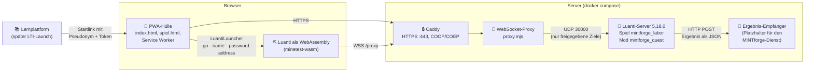

# Luanti-Web-Client (Prototyp)

> **Status: Prototyp, spielt im Browser – in CI.** Der WebAssembly-Client baut in CI (`luanti.wasm` ≈ 14 MB) und spielt
> im End-to-End-Test (Job `e2e`) in headless Chromium gegen Luanti 5.18.0: Start per Link, Anmeldung mit Token,
> Chat über die Tastatur, Quest gelöst, Ergebnis beim Empfänger. **Nicht geprüft:** echte Geräte (iPad, Chromebook,
> Schul-PC), Bildrate, mehrere Spieler:innen, Schulnetz. Nicht für den Unterricht freigegeben.

Hintergrund und Ziel stehen im Konzept, Abschnitt
[„Luanti-Web-Client (Prototyp)“](../../docs/konzept.md#luanti-web-client-prototyp): Luanti läuft als WebAssembly im
Browser (auch iPad/Safari und Chromebook), als PWA vom Startbildschirm, Start per Link mit kurzlebigem Token,
Mehrspieler über einen WebSocket-Proxy, und eine MINTforge-Mod prüft eine Quest und meldet das Ergebnis per HTTP.

Grundlage ist [paradust7/minetest-wasm](https://github.com/paradust7/minetest-wasm) (MIT), ein experimenteller
Emscripten-Port von Luanti. Wir übernehmen **keinen Fremdcode ins Repo**: Das Build-Skript klont eine feste Version
und baut sie.

## Architektur



Alles läuft über **einen Host und Port 443** (HTTPS und WSS), weil Schulnetze oft nichts anderes durchlassen.
Luanti-UDP bleibt im internen Netz.

### Bausteine

| Pfad | Was | Stand |
|---|---|---|
| [`wasm/build.sh`](wasm/build.sh) | klont minetest-wasm (Commit gepinnt), wendet [`wasm/patches/`](wasm/patches) an, baut im Docker-Container, legt das Ergebnis in `web/client/` | baut in CI (≈ 22 min) |
| [`web/`](web) | PWA-Hülle: Startseite, Spielseite, Manifest, Service Worker, Platzhalter-Icons | lokal getestet (Chrome) |
| [`server/proxy/`](server/proxy) | WebSocket↔UDP-Proxy, eigenes Gegenstück zum Client-Protokoll von minetest-wasm | lokal getestet, auch gegen einen echten Luanti-Server |
| [`server/docker-compose.yml`](server/docker-compose.yml) | Caddy (HTTPS + COOP/COEP), Proxy, Luanti-Server (offizielles Image, Version gepinnt), Ergebnis-Empfänger | `docker compose config` lokal geprüft; Start nur in CI |
| [`server/luanti/`](server/luanti) | Server-Einstellungen, minimales Spiel `mintforge_labor` (flache Laborwelt) | lokal geladen (Luanti 5.6.1) |
| [`mods/mintforge_quest/`](mods/mintforge_quest) | Lua-Mod: Anmeldung mit Token, Beispiel-Quest, automatische Prüfung, HTTP-POST | Logik getestet; im Spiel nicht durchgespielt |
| [`werkzeuge/`](werkzeuge) | `token.py` (Startlink erzeugen), `icons.py` (Platzhalter-Icons erzeugen) | lokal getestet |
| [`tests/`](tests) | Lua-Tests, Manifest-/Seitenprüfung, Playwright-Rauchtest | grün, lokal (Chrome) und in CI (Chromium, WebKit) |

### Startlink und Token

Die Lernplattform (später: der MINTforge-Dienst beim LTI-Launch) öffnet:

```text
https://labor.example/#server=luanti:30000&name=Fuchs_07&token=mf1-…&proxy=wss://labor.example/proxy
```

- Die Werte stehen im **Fragment** (`#…`), damit das Token nicht in Server-Logs oder im Referer landet. Die
  Spielseite entfernt es nach dem Lesen aus der Adresszeile.
- `name` ist ein **Pseudonym** (`[A-Za-z0-9_-]`, höchstens 20 Zeichen, Luanti-Grenze). Klarnamen kommen nie ins Spiel.
- Luanti meldet mit SRP an; der Server muss das Passwort vorher kennen. Das **Token ist deshalb ein abgeleitetes
  Passwort**: `"mf1-" + HMAC-SHA256(schlüssel, "mf1|<pseudonym>|<zeitfenster>")[:24 Hex]`, gültig im laufenden
  Zeitfenster (Standard ein UTC-Tag). Server (`mods/mintforge_quest/token.lua`) und Aussteller
  (`werkzeuge/token.py`) rechnen unabhängig; CI prüft, dass beide dasselbe Ergebnis liefern.
- Die Mod registriert dafür einen eigenen Auth-Handler (`core.register_authentication_handler`): Für jeden gültigen
  Namen liefert sie den Passwort-Hash des aktuellen Tokens. Freie Registrierung gibt es nicht.
- Der Schlüssel steht **nur** in `server/.env` (nicht im Repo) und im Dienst, der die Links erzeugt.

> **Bewusste Vereinfachung:** „Kurzlebig“ heißt hier „gilt bis Ende des Zeitfensters“, nicht „einmal verwendbar“.
> Wer einen Link abfängt, kann ihn am selben Tag nutzen. Für den Pilot braucht es kürzere Fenster oder ein
> Einmal-Token, das der Dienst beim Server hinterlegt (siehe [Offen](#offen)).

### Beispiel-Quest „Gehege“

Beim Betreten der Welt bekommt jede:r Zaun und die Aufgabe: *Baue mit dem Zaun ein rechteckiges Gehege, das innen
genau 24 Blöcke Fläche hat.* Sobald ein Zaun ein geschlossenes Rechteck bildet, prüft die Mod automatisch (kein
Klick nötig) und antwortet z. B. „innen 4 × 6 = 24 Blöcke, Zaunlänge 24. Geschafft!“ – oder wie viele Blöcke
fehlen. So lassen sich verschiedene Formen mit gleicher Fläche und unterschiedlichem Umfang vergleichen
(1 × 24 braucht 54 Zaunblöcke, 4 × 6 nur 24).

Jede erkannte Form wird als JSON per `POST` an `mintforge.ergebnis_url` gemeldet (nur Pseudonym, Welt, Quest,
Maße, Zeitstempel). Lehrkräfte (`mintforge.lehrkraefte`) können mit `/quest_alle` die Quest für alle neu starten.

## Prüfliste aus dem Konzept

Was der Prototyp beweisen muss (auf einem Schul-iPad, einem Chromebook und einem Windows-Schulgerät). An echten
Geräten ist noch nichts davon geprüft; was CI schon zeigt, steht in Klammern.

- [ ] Start aus Moodle in die Welt in unter 30 Sekunden *(ohne Moodle: Startlink → Spieler in der Welt in wenigen
  Sekunden, in CI auf localhost – kein Maß für Schulnetz oder Tablet)*
- [ ] flüssig spielbar (Ziel ≥ 30 Bilder pro Sekunde) mit 25 Schüler:innen in einer Welt *(nicht gemessen; in CI
  rendert SwiftShader in Software, eine Spielerin)*
- [ ] Touch-Steuerung ist ohne Erklärung bedienbar
- [ ] läuft im Schulnetz (nur HTTPS/WSS über Port 443) *(Aufbau dafür steht und läuft in CI: alles über Caddy auf
  443, Spiel über WSS)*
- [ ] eine Quest wird automatisch geprüft, das Ergebnis landet in Moodle *(bis zum Empfänger bewiesen, Moodle fehlt)*

Zwischenschritte:

- [x] Proxy übersetzt das Client-Protokoll von minetest-wasm in UDP und erreicht einen echten Luanti-Server
  (lokal mit Luanti 5.6.1; in CI mit dem offiziellen Image 5.18.0)
- [x] Proxy leitet nur an freigegebene Luanti-Server weiter, nicht ins Internet
- [x] Alles über einen HTTPS-Port, Seite cross-origin-isoliert (COOP/COEP)
- [x] PWA-Hülle: Manifest, Service Worker, Icons, Start per Link, Token aus der Adresszeile entfernt
- [x] Quest-Prüfung als getestete Logik, Ergebnis per HTTP-POST
- [x] WebAssembly-Client baut in CI (mit Cache: unveränderter Stand in Sekunden statt ≈ 22 min)
- [x] Client startet aus der Hülle mit `--go` ohne Hauptmenü direkt in die Welt (E2E a, b)
- [x] Name `luanti` wird über den Namensdienst des Proxys aufgelöst, Client 5.18.0-dev (Protokoll 53) verbindet sich
  mit Server 5.18.0 (Protokoll 54) (E2E a)
- [x] Anmeldung mit Token klappt; falsches Token wird abgelehnt (E2E b, d)
- [x] Tastatureingabe im Browser erreicht das Spiel: Chat-Befehl kommt beim Server an (E2E c1)
- [x] Quest wird automatisch geprüft, Ergebnis mit Pseudonym kommt per POST beim Empfänger an (E2E c) – das Gehege
  baut die Testhilfe der Mod (`/test_gehege`), nicht eine Person mit der Maus
- [ ] Gehege von Hand mit Maus/Touch bauen (nicht automatisiert)
- [ ] Token taucht nicht in der Browser-Konsole auf – **schlägt fehl**, siehe [Risiken](#risiken) (E2E e)

## Lokal starten

Voraussetzungen: Docker mit Compose, Python 3, Node.js 24 (nur für Tests).

```bash
cd prototypes/webclient

# 1. Client bauen (dauert lange; alternativ das Artifact „webclient-wasm“ aus dem CI-Lauf nach web/client/ entpacken)
wasm/build.sh

# 2. Schlüssel anlegen (nie committen)
cp server/env.beispiel server/.env
python3 -c "import secrets; print('MINTFORGE_TOKEN_SCHLUESSEL=' + secrets.token_hex(32))" >> server/.env

# 3. Stack starten
cd server && docker compose up -d && cd ..

# 4. Startlink erzeugen und im Browser öffnen (Zertifikatswarnung von Caddy einmal bestätigen)
set -a; . server/.env; set +a
python3 werkzeuge/token.py Fuchs_07 --basis https://localhost:8443/

# Ergebnisse ansehen
docker compose -f server/docker-compose.yml logs -f ergebnis
```

Für Geräte im selben Netz (iPad, Chromebook) `MINTFORGE_HOST` auf den Rechnernamen setzen. Mit `tls internal`
vertrauen Geräte dem Zertifikat nicht von selbst; für Tests auf echten Geräten braucht es einen Testserver mit
Domain (Let's Encrypt) – das kostet Geld und ist mit Andreas abzustimmen.

### Tests

```bash
cd prototypes/webclient
luacheck mods tests && luajit tests/lua/test_mod.lua        # Lua
python3 werkzeuge/icons.py --check                          # Icons aktuell
(cd server/proxy && npm ci && npm test)                     # Proxy
(cd tests && npm ci && npx html-validate ../web/*.html && node pruefe-manifest.mjs ../web)
(cd tests && npx playwright install chromium webkit && npx playwright test)

# End-to-End (braucht web/client/ aus dem Build und den laufenden Stack mit MINTFORGE_TESTMODUS=1)
(cd tests && npx playwright install chromium && npx playwright test -c playwright.e2e.config.mjs)
```

### End-to-End-Test im Browser

`tests/e2e/webclient.spec.mjs` startet den echten WebAssembly-Client in **headless Chromium 156.0.8078.4**
(Playwright 1.64.1; JSPI ist dort ohne Flag aktiv) gegen den Compose-Stack. WebGL 2 läuft ohne GPU über SwiftShader
(`--use-angle=swiftshader --enable-unsafe-swiftshader`). Belege kommen aus Server-Logs (`docker compose logs`) und der
Browser-Konsole:

| Test | Prüft | Beleg |
|---|---|---|
| a | Browser isoliert, JSPI und WebGL 2 vorhanden; Client verbindet sich | Server: `Fuchs_07 [...] joins game`; Konsole: `Connected to luanti (10.77.0.1:30000)`; Proxy: `BIND` |
| b | Anmeldung mit Token, Spielfigur in der Welt | Mod-Log `TEST: Fuchs_07 ist in der Welt bei (0,9,0)`; Bildschirmfoto |
| c1 | Tastatur → Chat-Befehl `/test_gehege` | Mod-Log `TEST: /test_gehege von Fuchs_07` |
| c | Quest gelöst, Ergebnis beim Empfänger | `ERGEBNIS {"flaeche":24,"geschafft":true,…,"pseudonym":"Fuchs_07",…}` |
| d | falsches Token abgelehnt | Server: `User Dachs_12 … supplied wrong password`; Konsole: „Zugriff verweigert. Grund: Falsches Passwort“ |
| e | Token nicht in der Konsole | **erwartet fehlschlagend** (`test.fail`), siehe Risiken |

Die **Testhilfe** der Mod ist nur aktiv, wenn der Server mit `MINTFORGE_TESTMODUS=1` läuft: Sie meldet die Position
der Spielfigur, registriert `/test_gehege` (baut ein 4 × 6-Gehege neben der Figur und prüft es wie beim Bauen) und
baut es 60 s nach dem Beitritt selbst, falls die Tastatur nicht ankommt. Im Unterricht bleibt die Variable leer.

Bildschirmfotos, Video, Server-, Proxy-, Web- und Empfänger-Logs sowie die Browser-Konsole landen im Artifact
`webclient-e2e` (auch bei Fehlschlag); die Kernbelege stehen zusätzlich im Job-Log unter „Belege im Log
zusammenfassen“.

### CI (`.github/workflows/webclient.yml`)

Läuft nur bei Änderungen unter `prototypes/webclient/**`. Actions sind auf Commit-SHA gepinnt.

| Job | Prüft |
|---|---|
| `lua` | luacheck, Tests der Mod-Logik mit LuaJIT, Token-Gleichheit Lua ↔ Python |
| `huelle` | Icons aktuell, html-validate, Manifest- und Seitenregeln (CSP, `lang`, keine Inline-Skripte/-Styles, keine externen Ressourcen), Playwright in Chromium und WebKit |
| `server` | shellcheck, `docker compose config`, Proxy-Tests, Stack-Start, Mod lädt im offiziellen Luanti-Image, Handshake Proxy → Luanti, HTTPS-Header |
| `wasm-build` | kompletter Emscripten-Build, Ergebnis als Artifact `webclient-wasm` (14 Tage); Cache-Schlüssel aus `wasm/build.sh` (gepinnte Commits, Versionen) und `wasm/patches/`, bei Treffer kein Neubau |
| `e2e` | Client aus `webclient-wasm` gegen den Compose-Stack in headless Chromium, siehe oben; Artifact `webclient-e2e` |

## Was funktioniert und was Gerüst ist

| Teil | Status | Belegt durch |
|---|---|---|
| Proxy-Protokoll (NEWADDR, BIND, Kapselung, Namensdienst) | ✅ funktioniert | `server/proxy/test/proxy.test.mjs`; Gegenstück aus `webshims/src/emsocket/proxy.js` und `emsocket.cpp` abgeleitet |
| Proxy ↔ echter Luanti-Server | ✅ funktioniert | `test/luanti-handshake.mjs`: Server vergibt über den Proxy eine Peer-ID |
| Mod lädt, Auth-Handler aktiv | ✅ lokal mit Luanti 5.6.1, in CI mit dem offiziellen Image 5.18.0 | Log „Anmeldung mit Token aktiv“, „mintforge_quest geladen“ |
| Quest-Prüfung, Token-Berechnung | ✅ funktioniert | `tests/lua/test_mod.lua` (14 Tests) |
| PWA-Hülle | ✅ in Chromium und WebKit (CI) | Playwright: Isolation, Manifest, Service Worker, Startlink, 390 px |
| WebAssembly-Build | ✅ in CI | Job `wasm-build`, Artifact `webclient-wasm`; zwei kleine Patches nötig (zstd und libzip nur statisch, siehe `wasm/patches/README.md`). Lokal nicht getestet (kein Zugriff auf Docker Hub/nodejs.org in der Arbeitsumgebung) |
| Client startet aus der Hülle direkt in die Welt | ✅ in CI (Chromium) | E2E a, b; Bildschirmfotos |
| Namensauflösung und Verbindung über den Proxy | ✅ in CI | E2E a: `Connected to luanti (10.77.0.1:30000)` |
| Anmeldung mit Token, falsches Token abgelehnt | ✅ in CI | E2E b, d |
| Tastatur im Spiel | ✅ in CI | E2E c1 (Chat) |
| Ergebnis per HTTP | ✅ in CI | E2E c: POST mit Pseudonym beim Empfänger |
| Token nicht in der Konsole | ❌ schlägt fehl | E2E e, siehe Risiken |
| Service Worker mit selbst signiertem Zertifikat | ❌ im E2E nicht registriert | Konsole: „An SSL certificate error occurred when fetching the script“ – Chromium registriert Service Worker nur mit gültigem Zertifikat; mit echter Domain zu prüfen |
| Menü-Knöpfe von `launcher.js` (Zahnrad) | ⚪ nicht geprüft | CSP blockiert die `onclick`-Attribute wie erwartet (6 Meldungen in der Konsole); ob das Neu-Verdrahten in `spiel.js` greift, testet niemand |
| Touch-Steuerung | ⚪ nur Luantis eigene | `touch_controls = auto`; keine eigene Anpassung |
| LTI / Moodle | ⚪ nicht Teil dieses Prototyps | kommt mit dem MINTforge-Dienst (Phase 3) |

## Offen

Fragen, die wir mit diesem Gerüst nicht beantworten konnten. Nichts davon ist geraten – wo es unklar ist, steht es hier.

Durch den E2E-Test geklärt (01.11.2026): Protokoll 53 ↔ 54 verbindet sich; `--go` mit `--address` geht ohne Menü
und ohne Bestätigungsdialog in die Welt; `luanti` wird über den Proxy aufgelöst; Medien kommen für dieses kleine
Spiel über das Spielprotokoll (kein `remote_media` nötig – bei größeren Spielen erneut prüfen).

1. **Inline-Handler in `launcher.js`.** Die CSP der Spielseite blockiert `onclick`-Attribute aus `launcher.js`;
   `spiel.js` hängt die Handler neu an, und `style-src 'unsafe-inline'` bleibt vorerst. Sauber wird es erst im
   eigenen Fork.
2. **Speicher und Threads.** `build_luanti.sh` setzt `INITIAL_MEMORY=2013265920` (≈ 1,9 GB) und
   `PTHREAD_POOL_SIZE=22`. Ob ältere Schul-iPads das schaffen, ist die größte offene Frage.
3. **Einmal-Token.** Für den Pilot: Token mit Minuten statt Tag Gültigkeit oder Einmal-Token, das der Dienst dem
   Server mitteilt; Schlüsselrotation.
4. **Ergebnis-Rückweg.** Der Empfänger ist ein Platzhalter. Der echte Weg führt über den MINTforge-Dienst und LTI
   AGS in die Bewertung von Moodle.
5. **Image-Digest.** `ghcr.io/luanti-org/luanti:5.18.0` und `caddy:2.11.7-alpine` sind per Tag gepinnt, noch nicht
    per Digest; die Digests lassen sich erst aus einem CI-Lauf ablesen.
6. **Echte Geräte und Bildrate.** Der E2E-Test läuft in headless Chromium mit Software-Rendering auf localhost. Über
   iPad/Safari (der E2E-Test läuft bisher nur in Chromium, WebKit ist nicht geprüft), Chromebook, Bildrate,
   25 Spieler:innen und Schulnetz sagt er nichts.

## Risiken

- **Token in der Browser-Konsole (Befund aus dem E2E-Test).** Der Luanti-Fork gibt beim Start alle Argumente auf
  stdout aus (`paradust7/luanti` 6f532b5, `src/mainloop.cpp`: `std::cout << "    " << main_argv[i]`), und
  `launcher.js` leitet stdout in die Konsole – also auch `--password mf1-…`. Wer an das Gerät kommt, kann das Token
  dort am selben Tag lesen. Abhilfe nur im eigenen Fork (Argumente nicht ausgeben oder maskieren); Test e ist bis
  dahin als erwartet fehlschlagend markiert.

- **Experimenteller Port, eine Person.** minetest-wasm wird von einer Person gepflegt und nennt sich selbst
  experimentell („only been tested on Ubuntu 20.04“). Ein eigener Fork kostet laufend Zeit.
- **Browser-Voraussetzungen.** Der Port braucht JSPI (seit dem Umbau vom 30.07.2026), Threads mit
  SharedArrayBuffer (Cross-Origin-Isolation), WebGL 2 und OffscreenCanvas. JSPI gibt es laut
  [web-features](https://web-platform-dx.github.io/web-features-explorer/features/wasm-jspi/) erst ab Chrome/Edge
  137, Firefox 153 und **Safari 27 (iOS/iPadOS 27, September 2026)**. Ältere iPads, die nicht auf iPadOS 27
  aktualisieren können, fallen damit heraus – das kann an Schulen viele Geräte betreffen.
- **Speicher.** ≈ 1,9 GB Startspeicher (siehe oben) ist für Tablets viel; Safari beendet Tabs bei Speichermangel.
- **Schulnetz.** Manche Filter blockieren WebSockets oder große Downloads (`luanti.wasm`). Muss an echten
  Schulnetzen getestet werden.
- **Kosten.** Ein öffentlich erreichbarer Testserver (Hetzner) und eine Domain kosten Geld – nur nach Absprache.
- **Lizenzen.** Luanti ist LGPL-2.1, minetest-wasm und webshims MIT, Code hier EUPL-1.2. Beim Ausliefern des
  gebauten Clients müssen die Lizenztexte mit (der Build legt sie bisher nicht gesammelt ab – TODO).

## Quellen

- [paradust7/minetest-wasm](https://github.com/paradust7/minetest-wasm) @ `5bfae52` – README, `build_*.sh`,
  `install_emsdk.sh`, `static/launcher.js`, `static/htaccess_*`
- [paradust7/webshims](https://github.com/paradust7/webshims) @ `70653a9` – `src/emsocket/proxy.js`,
  `emsocket.cpp`, `VirtualSocket.cpp`, `emsocketctl.cpp`. Der Proxy-Server des Autors (`wss://…dustlabs.io`) ist
  **nicht** veröffentlicht; `server/proxy/proxy.mjs` ist ein eigenes Gegenstück zum Client-Code.
- [luanti-org/luanti](https://github.com/luanti-org/luanti) @ Tag `5.18.0` – `doc/lua_api.md`, `Dockerfile`,
  `.github/workflows/docker_image.yml`, `src/network/mtp/*`, `src/client/clientlauncher.cpp`,
  `builtin/game/auth.lua`

---

<sub>Kein offizielles Minecraft-Produkt. Nicht von Mojang oder Microsoft genehmigt oder mit ihnen verbunden.</sub>
